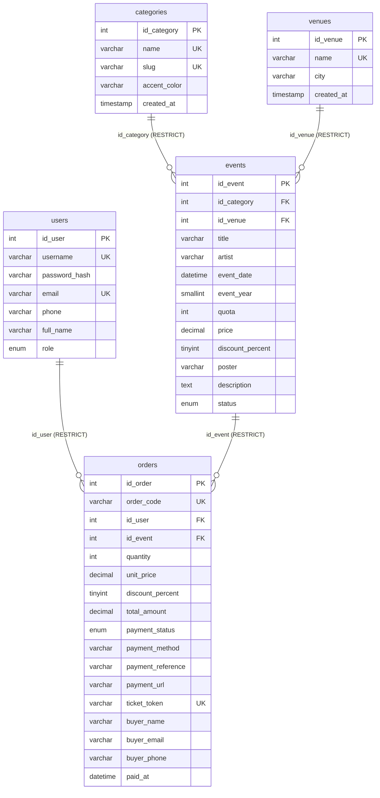

<div align="center">
  

  <h1>TIXORA — Sistem Manajemen Tiket Konser</h1>

  <p>
    <strong>Ticket Index, Order &amp; Reservation Application</strong><br>
    Aplikasi web manajemen &amp; pemesanan tiket konser berbasis <strong>PHP 8</strong> &amp; <strong>MySQL/MariaDB (3NF)</strong> dengan checkout aman, payment gateway <strong>Bayar.GG</strong>, dan <strong>E-Ticket QR</strong> terverifikasi.
  </p>

  <p>
    
    
    
    
    
  </p>
</div>

---

## Daftar Isi

- [Tentang Project](#tentang-project)
- [Fitur Utama](#fitur-utama)
- [Arsitektur & Skema Basis Data (3NF)](#arsitektur--skema-basis-data-3nf)
- [Keamanan Aplikasi](#keamanan-aplikasi)
- [Tech Stack](#tech-stack)
- [Struktur Direktori](#struktur-direktori)
- [Instalasi & Menjalankan Lokal](#instalasi--menjalankan-lokal)
- [Konfigurasi Environment (.env)](#konfigurasi-environment-env)
- [Akun Demo](#akun-demo)
- [Alur Aplikasi](#alur-aplikasi)
- [Author](#author)

---

## Tentang Project

**TIXORA** (*Ticket Index, Order & Reservation Application*) adalah sistem manajemen dan pemesanan tiket konser berbasis web yang dirancang sebagai **Tugas Akhir Praktikum Basis Data** sekaligus siap dikembangkan ke skala produksi.

Aplikasi ini menggabungkan katalog event musik publik, proses checkout & integrasi payment gateway, penerbitan **TIXORA Official E-Pass** (QR code berbasis HMAC-SHA256), serta panel manajemen administrator dengan basis data relasional yang telah dinormalisasi ke **Third Normal Form (3NF)**.

---

## Fitur Utama

### Pengunjung & Member
- **Katalog Konser Interaktif**: Pencarian real-time berdasarkan judul event, artis/line-up, atau lokasi venue, dilengkapi filter genre musik, badge promo diskon, dan indikator ketersediaan kuota secara langsung.
- **Detail Event Lengkap**: Menampilkan poster resmi, tanggal & jam pelaksanaan nyata (`DATETIME`), lokasi venue beserta kota, deskripsi event, serta estimasi total tiket.
- **Checkout Aman**: Formulir data pemesan tervalidasi, perhitungan harga & diskon 100% di sisi server, dukungan klaim promo 100% (gratis), dan integrasi pembayaran QRIS / e-wallet via **Bayar.GG**.
- **Riwayat Pesanan & Reopen Pembayaran**: Memantau status pesanan (`pending`, `paid`, `expired`, `canceled`, `failed`), membuka ulang tautan pembayaran yang masih pending, atau membatalkan pesanan.
- **TIXORA Official E-Pass**: E-Ticket siap cetak/simpan PDF dengan kode QR token HMAC unik untuk verifikasi gerbang venue.
- **Manajemen Profil & Password**: Memperbarui nama, email, nomor HP, serta mengganti password dengan verifikasi password lama.

### Administrator
- **Dashboard KPI Ringkasan**: Statistik total event, kuota tersisa, tiket terjual, transaksi lunas/pending, dan total pendapatan.
- **Manajemen Event (CRUD)**: Tambah, ubah, dan hapus event konser lengkap dengan pilihan genre, venue, jadwal pelaksanaan, harga, diskon promo, kuota, deskripsi, dan upload poster aman.
- **Preview E-Ticket**: Pratinjau tampilan desain E-Pass untuk setiap event langsung dari panel admin.
- **Kelola Data Referensi (Genre & Venue)**: Manajemen tabel master `categories` (beserta warna aksen) dan `venues` (beserta kota) dengan proteksi integritas referensial.
- **Monitoring Transaksi**: Tabel seluruh pesanan dengan filter status pembayaran dan pencarian kode pesanan/pembeli/event.

---

## Arsitektur & Skema Basis Data (3NF)

Basis data `db_tixora` dirancang memenuhi normalisasi **3NF** dengan relasi **Foreign Key (`ON DELETE RESTRICT ON UPDATE CASCADE`)**, **CHECK Constraints**, **Composite Indexes**, **Views**, dan **Triggers** (kompatibel dengan **MariaDB 10.4+** / XAMPP maupun **MySQL 8.0/8.4+** / Laragon).

### Entity Relationship Diagram (ERD)



### Objek Basis Data

| Jenis | Nama Objek | Keterangan |
|---|---|---|
| **Table** | `categories` | Master genre/jenis event (`UNIQUE` pada `name` & `slug`). |
| **Table** | `venues` | Master lokasi/arena konser beserta kota (`UNIQUE` pada `name`). |
| **Table** | `events` | Data konser dengan FK ke `categories` & `venues`, `CHECK` harga/diskon/tahun, serta indeks `(status, event_date)`. |
| **Table** | `users` | Data autentikasi (`password_hash` bcrypt/argon2, `role` `admin`/`user`). |
| **Table** | `orders` | Transaksi tiket dengan snapshot `unit_price` & `discount_percent`, `ticket_token` unik, dan indeks `payment_reference` & `(payment_status, created_at)`. |
| **View** | `v_event_catalog` | Join `events` + `categories` + `venues` beserta kolom terhitung `final_price` dan `availability_label`. |
| **View** | `v_transaction_summary` | Join lengkap transaksi (`orders`, `users`, `events`, `categories`, `venues`) untuk laporan & riwayat pesanan. |
| **Trigger** | `trg_events_status_before_insert` & `trg_events_status_before_update` | Otomatis mengubah `events.status` menjadi `'sold_out'` saat `quota = 0` dan kembali ke `'active'` saat kuota diisi ulang. |
| **Transaction** | `selesaikanPembayaranOrder()` | Pengurangan kuota dan konfirmasi lunas dijalankan atomik menggunakan `BEGIN TRANSACTION` + row lock `SELECT ... FOR UPDATE` untuk mencegah *overselling*. |

---

## Keamanan Aplikasi

| Aspek Keamanan | Implementasi di TIXORA |
|---|---|
| **Anti SQL Injection** | 100% query menggunakan `mysqli::prepare()` & `bind_param()`. |
| **Anti Payment Bypass & Price Tampering** | Harga & diskon dihitung eksklusif di server; halaman konfirmasi tidak pernah mempercayai parameter URL; status lunas hanya diproses melalui verifikasi gateway/webhook. |
| **Anti CSRF** | Token CSRF (`hash_equals`) pada seluruh form mutasi (`POST`), termasuk hapus data admin, batal pesanan, dan logout. |
| **Anti XSS** | Escaping HTML terpusat via fungsi `e()` (`ENT_QUOTES`, UTF-8) dan sistem pesan flash berbasis session. |
| **Upload Poster Aman** | Validasi MIME biner nyata via `finfo` + `getimagesize()`, nama file acak kriptografis (`random_bytes`), serta penonaktifan eksekusi skrip PHP via `assets/uploads/.htaccess`. |
| **Session & Auth Hardening** | Cookie `HttpOnly` + `SameSite=Lax` + `use_strict_mode`, `session_regenerate_id(true)` saat login/ganti password, dan rate limit login (5 percobaan gagal per 5 menit). |
| **Webhook Integrity** | Verifikasi signature HMAC-SHA256 + batas jendela waktu replay (300 detik) + validasi nominal `final_amount >= total_amount`. |
| **Secret & Access Protection** | Seluruh kredensial dipisah ke `.env` (diabaikan di `.gitignore`), serta pemblokiran akses langsung `.env`, `.sql`, `includes/`, dan `database/` di `.htaccess`. |

---

## Tech Stack

- **Backend**: PHP 8.1+ (Native, tanpa framework eksternal, ekstensi `mysqli`, `curl`, `fileinfo`)
- **Database**: MySQL 8.0+ / MariaDB 10.4+ (InnoDB, `utf8mb4_unicode_ci`)
- **Frontend**: HTML5 Semantik, Vanilla CSS (Design System Warm Alabaster + Obsidian Ink + Ember Coral), Vanilla JavaScript
- **Tipografi**: Outfit (Display), Plus Jakarta Sans (UI), JetBrains Mono (Kode & Angka Tabular)
- **Payment Gateway**: Bayar.GG REST API & Webhook (QRIS / GoPay QRIS / BRI QRIS / OVO)

---

## Struktur Direktori

```text
tixora/
├── .env.example                    # Template variabel lingkungan
├── .gitignore                      # Daftar file sensitif yang diabaikan Git
├── .htaccess                       # Security headers & blokir akses direktori internal
├── README.md                       # Dokumentasi utama project
├── index.php                       # Halaman beranda & katalog event publik
│
├── admin/                          # Panel Administrator (dilindungi requireAdmin())
│   ├── index.php                   # Dashboard KPI & daftar seluruh tiket event
│   ├── tambah.php                  # Form tambah event konser baru
│   ├── edit.php                    # Form ubah detail & poster event
│   ├── hapus.php                   # Endpoint POST + CSRF hapus event
│   ├── kelola.php                  # Kelola tabel referensi genre & venue
│   └── transaksi.php               # Monitoring & filter seluruh transaksi
│
├── auth/                           # Modul Autentikasi
│   ├── login.php                   # Halaman masuk (CSRF + rate limiting)
│   ├── register.php                # Halaman pendaftaran akun member
│   └── logout.php                  # Endpoint POST + CSRF keluar sesi
│
├── pages/                          # Halaman Member & Publik
│   ├── detail.php                  # Halaman detail konser & pilih jumlah tiket
│   ├── beli_tiket.php              # Formulir data pemesan & ringkasan checkout
│   ├── pesanan_saya.php            # Riwayat pesanan, reopen bayar & pembatalan
│   ├── profil.php                  # Informasi profil & ubah password
│   └── e_ticket.php                # TIXORA Official E-Pass (QR code siap cetak)
│
├── payment/                        # Modul Pembayaran & Gateway
│   ├── gateway.php                 # Client HTTP Bayar.GG + verifikasi HMAC webhook
│   ├── process.php                 # Proses checkout baru & reopen pending order
│   ├── waiting.php                 # Halaman tunggu pembayaran (polling real-time)
│   ├── check_status.php            # JSON endpoint cek status pembayaran
│   ├── success.php                 # Konfirmasi pesanan (verifikasi server-side)
│   └── webhook.php                 # Callback webhook Bayar.GG
│
├── includes/                       # Inti Aplikasi & Layout Partials
│   ├── env.php                     # Loader file .env ringan
│   ├── security.php                # Session hardening, CSRF, escaping, rate limit, HMAC
│   ├── config.php                  # Koneksi MySQLi berbasis .env
│   ├── bootstrap.php               # Inisialisasi aplikasi, BASE_URL aman & sweep order
│   ├── auth.php                    # Helper login, register, logout & role guard
│   ├── functions.php               # Operasi CRUD (100% Prepared Statements) & upload aman
│   └── partials/
│       ├── head.php                # Shared <head> & font loader
│       ├── navbar.php              # Navigasi publik responsif + mobile drawer
│       ├── admin_sidebar.php       # Sidebar admin responsif + mobile drawer
│       └── footer.php              # Footer resmi TIXORA
│
├── assets/
│   ├── css/style.css               # Stylesheet utama TIXORA Design System
│   ├── icon/                       # Logo_Light.svg & Icon_Mark.svg
│   └── uploads/                    # Poster event + .htaccess anti-eksekusi PHP
│
└── database/
    ├── tixora.sql                  # Skema 3NF lengkap + Views + Triggers + data awal
    └── migrate_legacy.sql          # Script migrasi dari skema database versi lama
```

---

## Instalasi & Menjalankan Lokal

### Prasyarat
- PHP **8.1+** dengan ekstensi `mysqli`, `curl`, `fileinfo` aktif
- MySQL **8.0+** (Laragon) atau MariaDB **10.4+** (XAMPP)

### Langkah Setup

1. **Clone repository**
   ```bash
   git clone https://github.com/ngnawfal/tixora.git
   cd tixora
   ```

2. **Import database `db_tixora`**
   - Melalui **phpMyAdmin**: buka tab *Import*, pilih file `database/tixora.sql`, lalu jalankan.
   - Atau melalui **MySQL/MariaDB CLI**:
     ```bash
     mysql -u root < database/tixora.sql
     ```

3. **Salin dan sesuaikan file `.env`**
   ```bash
   cp .env.example .env
   ```
   Sesuaikan nilai `DB_HOST`, `DB_NAME`, `DB_USER`, `DB_PASS`, dan `APP_KEY` di `.env`.

4. **Jalankan aplikasi**
   - Menggunakan PHP built-in server:
     ```bash
     php -S localhost:8000
     ```
     Lalu buka `http://localhost:8000/` di browser.
   - Atau letakkan folder di `htdocs/tixora` (XAMPP) / `www/tixora` (Laragon) dan akses melalui `http://localhost/tixora/`.

---

## Konfigurasi Environment (`.env`)

| Variabel | Default | Keterangan |
|---|---|---|
| `APP_NAME` | `TIXORA` | Nama aplikasi pada judul halaman & metadata. |
| `APP_ENV` | `local` | Lingkungan aplikasi (`local` / `production`). |
| `APP_URL` | *(kosong)* | URL dasar tetap (disarankan diisi di produksi untuk mencegah *Host Header Injection*). |
| `APP_KEY` | *(wajib isi)* | Kunci rahasia acak (min. 32 karakter) untuk tanda tangan HMAC E-Ticket. |
| `DB_HOST` | `127.0.0.1` | Host server MySQL/MariaDB. |
| `DB_PORT` | `3306` | Port server MySQL/MariaDB. |
| `DB_NAME` | `db_tixora` | Nama database TIXORA. |
| `DB_USER` | `root` | Username database. |
| `DB_PASS` | *(kosong)* | Password database. |
| `BAYARGG_API_KEY` | *(opsional)* | API Key dari dashboard Bayar.GG (untuk pembayaran berbayar). |
| `BAYARGG_WEBHOOK_SECRET` | *(opsional)* | Webhook Secret Key Bayar.GG untuk verifikasi callback HMAC. |
| `BAYARGG_VERIFY_SSL` | `true` | Verifikasi sertifikat TLS pada panggilan cURL gateway. |

> **Catatan:** Event dengan diskon `100%` (mis. *The Sounds Project* di data demo) dapat langsung diuji penuh hingga penerbitan **E-Ticket** tanpa memerlukan API Key Bayar.GG.

---

## Akun Demo

Setelah meng-import `database/tixora.sql`, akun berikut tersedia untuk pengujian lokal:

| Role | Username | Email | Password | Akses |
|---|---|---|---|---|
| **Administrator** | `admin` | `admin@tixora.id` | `password` | Panel Admin (`/admin/`), CRUD Event, Genre, Venue, Transaksi |
| **Member** | `user` | `user@example.com` | `password` | Pemesanan Tiket, Riwayat Pesanan, Profil, E-Ticket |

> [!WARNING]
> Segera ubah password akun bawaan melalui halaman **Profil Saya** sebelum men-deploy aplikasi ke server publik.

---

## Alur Aplikasi

```text
1. Pengunjung membuka Katalog (index.php) → Cari / Filter Genre
2. Klik Event → Halaman Detail (pages/detail.php) → Pilih Jumlah Tiket
3. Login / Daftar (auth/login.php) → Konfirmasi Data Pemesan (pages/beli_tiket.php)
4. Checkout Server-Side (payment/process.php):
   ├── Promo 100% (Rp 0) → Potong stok atomik (FOR UPDATE) → Konfirmasi & E-Ticket aktif
   └── Berbayar          → Buat invoice Bayar.GG → Tunggu Pembayaran (payment/waiting.php)
                           → Webhook HMAC (payment/webhook.php) → Potong stok atomik → Lunas
5. Member membuka & mencetak E-Ticket QR (pages/e_ticket.php)
```

---

## Author

Dikembangkan oleh **[@ngnawfal](https://github.com/ngnawfal)** — Tugas Akhir Praktikum Basis Data.
